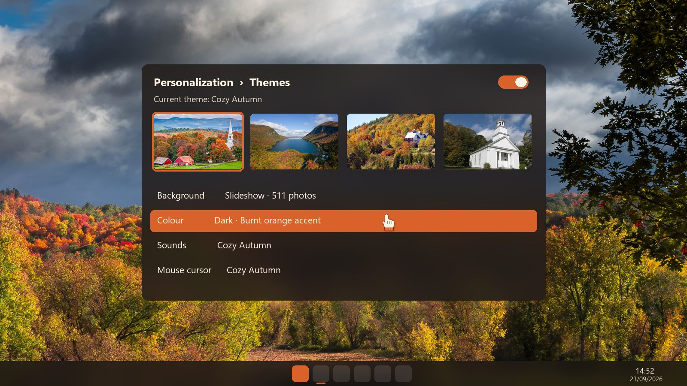
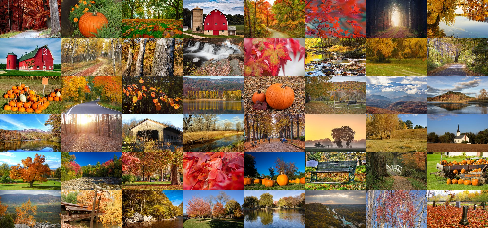
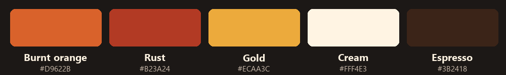
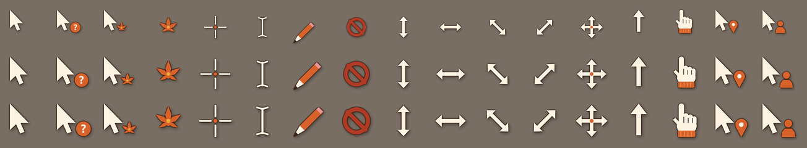
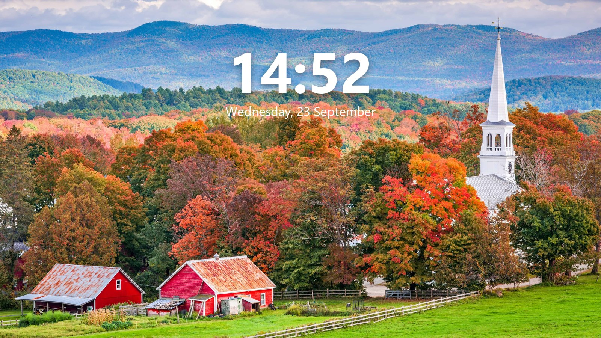

# 🍁 Cozy Autumn: a Windows 11 theme

Sweater weather for your desktop. **511 real autumn photographs** (Vermont villages, Pacific Northwest
forests, New England back roads, Stars Hollow vibes) plus a burnt-orange accent, dark mode, a
matching sound scheme and hand-drawn cursors.



## What's inside

| | |
|---|---|
| 🖼️ **Wallpapers** | 511 photos in a shuffled slideshow that changes every 30 minutes. They were picked for reds and oranges: every image passed a warm-pixel score and a manual review. |
| 🎨 **Colours** | Dark mode, burnt-orange accent `#D9622B` on the Start menu, taskbar, title bars and selection highlight |
| 🔔 **Sounds** | 20 soft, warm synthesised system sounds: logon/logoff, notifications, mail, reminders, errors, device connect, the recycle bin and more |
| 🖱️ **Cursors** | A full 17-cursor set in orange and cream, with an animated leaf spinner. Three size schemes: *Cozy Autumn*, *(Large)* and *(Extra Large)* |
| 🔒 **Lock screen** | An optional Vermont village with a white steeple and red barns |

### Wallpapers



### Palette



### Cursors



### Lock screen



## Install

```powershell
git clone https://github.com/giulioungaretti/cozy-autumn-theme.git
cd cozy-autumn-theme
powershell -ExecutionPolicy Bypass -File .\install.ps1 -Apply -LockScreen
```

* `install.ps1` copies the assets to `%LOCALAPPDATA%\Microsoft\Windows\Themes\CozyAutumn` and registers
  the sound and cursor schemes. It then writes `CozyAutumn.theme`.
* `-Apply` switches to the theme right away. Without it, pick **Cozy Autumn** in
  *Settings › Personalization › Themes*.
* `-LockScreen` also sets the lock screen picture. To use a different photo, run
  `.\set-lockscreen.ps1 -Image <path>`.

No admin rights are needed. Everything is per-user.

### Tips

* **Cursor size:** change it in **Mouse Properties › Pointers** (`main.cpl`) by picking the Large or
  Extra Large scheme. Don't use the *Settings › Accessibility › Mouse pointer* size slider: it replaces
  custom cursors with the Windows defaults. If that happens, run `install.ps1 -Apply` again.
* **Double-clicking the `.theme` file does nothing?** A hung *Settings* app can silently block theme
  changes. Close `SystemSettings.exe` in Task Manager and try again. `-Apply` does this for you.

## Uninstall

```powershell
powershell -ExecutionPolicy Bypass -File .\uninstall.ps1
```

This removes the theme, the sound and cursor schemes and the installed files. Afterwards, pick any
other theme in Settings.

## How it was made

`src/` contains the tooling used to build the theme:

| Script | Purpose |
|---|---|
| `fetch_wallpapers.py`, `fetch_commons2.py` | Search Wikimedia Commons for high-resolution autumn photos (≥1920 px) and record their licenses |
| `fetch_more.py`, `fetch_bing2.py`, `fetch_bing3.py` | Additional searches on Openverse and Bing Images |
| `warmth.py` | Score each image by its fraction of red/orange pixels |
| `finalize.py` | Warmth filter, perceptual-hash dedupe and `CREDITS.md` generation |
| `contact.py` | Contact sheets for the manual review |
| `sounds.py` | Synthesises the 20 WAV sounds from scratch |
| `cursors.py` | Draws the cursors with supersampling and writes multi-resolution `.cur`/`.ani` files (32–256 px) in three size variants |

## Credits and licensing

* **Scripts** (`*.ps1`, `src/`) are MIT licensed. See [LICENSE](LICENSE).
* **Sounds and cursors** were generated by `src/sounds.py` and `src/cursors.py` and are also MIT.
* **Photos** belong to their photographers. [CREDITS.md](CREDITS.md) lists the source page, author and
  license for every image.
  * The 168 files whose names start with a number come from Wikimedia Commons or Openverse. Each has
    a verified Creative Commons or public-domain license.
  * The 343 files starting with `bi-` came from Bing Images with its Creative Commons filter, but
    **their licenses have not been verified**. Treat them as personal-use only.

This repository is **private** because of the Bing images. To publish a public version, delete
`Wallpapers\bi-*.jpg` first; the remaining 168 images all have verified licenses and credits.
